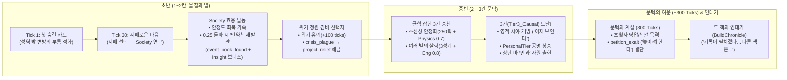

# Cosmic Ascension — 게임 디자인 전수 감사 및 설계 보완서 (DESIGN_AUDIT_AND_IMPROVEMENT)

- **작성일**: 2026-10-24
- **문서 성격**: 프로젝트 전체 설계 문서(`docs/`) 및 실제 정의 데이터(`Tools/data/DT_*.json`, `ST_CA.csv`), 아키텍처 불변식을 게임 디자인 관점에서 전수 조사한 **심층 크리틱 및 실질적 설계 보완 자료**.
- **검토 대상 원본**:
  - **기획/아키텍처**: [`STATUS.md`](../../STATUS.md), [`00_VISION.md`](../00_VISION.md), [`15_GLOSSARY.md`](../15_GLOSSARY.md), [`pillars.md`](pillars.md), [`systems.md`](systems.md), [`crisis_and_transcendents.md`](crisis_and_transcendents.md), [`20_ARCHITECTURE.md`](../20_ARCHITECTURE.md), [`21_DATA_MODEL_REFERENCE.md`](../21_DATA_MODEL_REFERENCE.md), [`50_ROADMAP.md`](../50_ROADMAP.md), [`70_CONTENT_GUIDE.md`](../70_CONTENT_GUIDE.md), [`90_LORE/theology_and_bestiary_notes.md`](../90_LORE/theology_and_bestiary_notes.md), [`DECISIONS_LOG.md`](../60_DECISIONS/DECISIONS_LOG.md), [`OPEN_QUESTIONS.md`](../60_DECISIONS/OPEN_QUESTIONS.md), MVP 헤더 [`A0`](../60_DECISIONS/headers/A0_sanctuary_first_life.md)~[`A7`](../60_DECISIONS/headers/A7_research_focus.md)
  - **인게임 정의 데이터**: [`DT_Rules.json`](../../Tools/data/DT_Rules.json), [`DT_Encounters.json`](../../Tools/data/DT_Encounters.json), [`DT_Events.json`](../../Tools/data/DT_Events.json), [`DT_Hazards.json`](../../Tools/data/DT_Hazards.json), [`DT_Feats.json`](../../Tools/data/DT_Feats.json), [`DT_Megaprojects.json`](../../Tools/data/DT_Megaprojects.json), [`DT_Transcendents.json`](../../Tools/data/DT_Transcendents.json), [`ST_CA.csv`](../../Tools/data/ST_CA.csv)
- **전제 조건**: 보편적인 대중 게임(전술 4X, 캐릭터 육성 RPG, 선악 카르마 미터 등)의 문법을 억지로 이식하지 않는다. 이 프로젝트가 선언한 고유 공리(**린 시뮬레이션, 요약 단위 원칙, `세계 → 앎 → 이야기` 단방향 인식론, 비설교적 신학 레이어**)를 극대화하는 방향에서 내부 논리와 시스템을 분석·보완한다.

---

## 목차 (Table of Contents)

- **Part I. 4대 핵심 축 심층 분석 및 초기 리뷰**
  - [0. 4대 핵심 축 기준 분석 요약](#0-4대-핵심-축-기준-분석-요약)
  - [1. 총평 및 핵심 강점 (Overall Assessment & Core Strengths)](#1-총평-및-핵심-강점-overall-assessment--core-strengths)
  - [2. 치명적 병목 및 모순점 (Critical Bottlenecks & Contradictions)](#2-치명적-병목-및-모순점-critical-bottlenecks--contradictions)
  - [3. 기본 개선 제안 (Core Improvement Proposals)](#3-기본-개선-제안-core-improvement-proposals)
- **Part II. 수석 게임 디렉터 크리틱: ‘개발자의 당연함’과 ‘첫 플레이어의 빈틈’**
  - [4. 당위성·흐름·시스템 과잉/결핍 크리틱 및 6대 핀포인트 처방](#4-수석-게임-디렉터-크리틱-개발자의-당연함과-첫-플레이어의-빈틈)
- **Part III. 실질적 설계 보완을 위한 4대 구조화 산출물 (5대 심화 기준 전수 조사)**
  - [자료 1. 설정-시스템 매핑 매트릭스 (Lore-to-Mechanic Matrix)](#자료-1-설정-시스템-매핑-매트릭스-lore-to-mechanic-matrix)
  - [자료 2. 플레이 흐름 및 인지 부하 분석표 (Player Flow & Pacing Map)](#자료-2-플레이-흐름-및-인지-부하-분석표-player-flow--pacing-map)
  - [자료 3. 취약점 및 리스크 진단 보고서 (Design Bottleneck Audit)](#자료-3-취약점-및-리스크-진단-보고서-design-bottleneck-audit)
  - [자료 4. 구체적인 개선 설계안 및 파일별 작업 목록 (Actionable Improvement Plan & To-Do)](#자료-4-구체적인-개선-설계안-및-파일별-작업-목록-actionable-improvement-plan--to-do)

---

# Part I. 4대 핵심 축 심층 분석 및 초기 리뷰

## 0. 4대 핵심 축 기준 분석 요약

| 분석 축 | 핵심 질문 | 진단 요약 |
| :--- | :--- | :--- |
| **1. 세계관 및 설정의 내적 일관성** (Worldbuilding & Lore) | 독창적 개념들이 충돌 없이 맞물리며, 거대한 개념이 규칙으로 치환되어 있는가? | **매우 우수하나 일부 법칙 간 경계 충돌 존재.** 불변 법칙(`ImmutableLaws`)과 모사품 원칙(`CounterfeitOf`)은 탁월하나, `Law.Remnant`(남은 자 법)가 단일 성계 문명에서 회귀 초월자의 귀환 유혹(`OfferReturn`) 대가를 0으로 상쇄하는 모순이 있음. |
| **2. 코어 루프와 플레이 흐름** (Structure & Flow) | 초반→중·후반 확장 흐름이 자연스럽고 루즈하거나 목적성을 잃는 구간이 없는가? | **초반 330틱의 공백과 배속별 체감 격차가 큼.** 첫 330틱 동안 성계 1개만 보이고 항로선이 없으며, 1칸 정기 청원 주기(300틱)가 길어 저배속에서 루즈함. 반면 고배속+연구 초점 전환 시 3칸 엔딩이 지나치게 빨리 도래함. |
| **3. 시스템과 서사의 결합도** (Ludonarrative Harmony) | 플레이 행위 자체가 세계관을 체감하게 만드는가? | **인식론적 로그 구조는 독보적이나, 두 가지 치명적 단절 존재.** ① 통치자 업적이 `PersonalTier`를 전혀 올리지 않아 하야/사망 시 시야와 칸이 1칸으로 추락함. ② 첫 청원(`petition_wise_heart`)의 ‘지혜(`Society`)’ 선택지가 해금 효과가 없는 함정 선택지로 작동함. |
| **4. 직관성 및 인지 부하** (Onboarding & Cognitive Load) | 낯선 개념과 규칙을 학습할 때 과도한 피로감이나 혼란이 없는가? | **요약 단위 추상화는 직관적이나, 숨겨진 지연/필터링 규칙이 혼란 유발.** 격틱 지불 시 자원 부족 경고가 뜨지 않는 문제(#103), 이미 조우한 문명(`MetCivs`)의 승천이 수도 미발견 시 익명으로 뜨는 문제(#69) 등 피드백 투명성 보완 필요. |

---

## 1. 총평 및 핵심 강점 (Overall Assessment & Core Strengths)

> **한 줄 총평**: 우주론과 신학적 명제를 ‘텍스트 장식’에 머물게 하지 않고 **시뮬레이션의 불변식(Invariant)과 인식론적 데이터 구조**로 직접 치환해 낸, 독보적인 깊이의 관조적 서사 시뮬레이션.

### 1.1 형이상학의 시스템 법칙화 (Axis 1: 세계관 및 내적 일관성)
대부분의 게임이 세계관을 이벤트 텍스트로만 전달하는 것과 달리, `Cosmic_Ascension`은 세계관의 핵심 공리를 [`DT_Rules.json`](../../Tools/data/DT_Rules.json)의 불변 법칙(`ImmutableLaws`)과 시뮬레이션 경계 조건으로 구현했다.
- **모사품 원칙 (`CounterfeitOf`)**: 타락 초월자의 4교리(`Silence`, `Assimilation`, `Zeal`, `Recurrence`)는 독립된 악의 축이 아니라, 거룩한 질서의 4가지 길인 안식(`Rest`), 연합(`Union`), 경배(`Worship`), 새롭게 됨(`Renewal`)을 각각 비튼 **위조품**으로 정의된다([`crisis_and_transcendents.md`](crisis_and_transcendents.md) 2.1절, [`70_CONTENT_GUIDE.md`](../70_CONTENT_GUIDE.md) 2.2절). 플레이어가 유혹을 분별하는 과정 자체가 곧 세계관의 핵심 주제를 학습하는 과정이 된다.
- **구조적 한계로서의 은총**:
  - **울타리 법 (`Law.Hedge`)**: 성역(`sol`)을 모든 소유·정착·주장·파괴·압력에서 면제하여 우주의 흔들리지 않는 기준점으로 삼음([`A0_sanctuary_first_life.md`](../60_DECISIONS/headers/A0_sanctuary_first_life.md)).
  - **남은 자 법 (`Law.Remnant`, `Sim.ClaimNeverTotal`)**: 타락 초월자가 아무리 강해도 문명의 마지막 미점령 정착 성계는 결코 삼키지 못하게 강제함.
  - **낮아짐의 법 (`Law.Humility`)**: 5칸에 스스로 오르려는 찬탈(`Way.Seized`)의 비가역성을 규정함.
- **실측 천문학 데이터와의 결합**: 20,000개의 실측 은하(`DT_Galaxies`) 위에 단 하나의 성역(`sol`, 0,0,0)을 두고, 첫 삶(First Life)에서 플레이어의 모성계(`sys_0`)와 성역(`sol`)을 분리함으로써 *"우리는 중심에서 시작하지 않으며, 중심의 부름을 향해 나아간다"*는 존재론적 구도를 공간적으로 구현했다.

### 1.2 인식론적 아키텍처: `세계 → 앎 → 이야기`의 단방향 분리 (Axis 3: 시스템과 서사의 결합도)
[`20_ARCHITECTURE.md`](../20_ARCHITECTURE.md) 2.5절과 [`70_CONTENT_GUIDE.md`](../70_CONTENT_GUIDE.md) 0절에 정의된 3계층 분리(`World → Knowing → Telling`)는 결정론적 시뮬레이션과 주관적 서사 체험을 동시에 달성한 핵심 설계다.
- **관측자의 칸(`Tier`)이 세계의 서술 해상도를 바꾼다**: 동일한 초월자의 개입이나 `Hazard.Claim`이 발생해도, `GetViewerTier()`가 1~2칸일 때는 자연 현상이나 징조의 은유(`Log.Sign`, `METAPHOR`)로 기록되고, 3칸(`SpiritualSightMinTier`) 이상에 도달해야 비로소 1인칭 유혹과 영적 실체(`Log.Claim`, `DIVINE_TITLE`)가 드러난다. 즉, **칸이 오른다는 것은 더 강한 무기를 얻는 것이 아니라 ‘이전까지 보이지 않던 우주의 이면을 읽게 되는 것’**으로 체감된다.
- **거리와 앎에 따른 서사 여과 (`Scope of Telling`)**: 플레이어가 알지 못하는 먼 문명의 사건은 `log_far_event`와 `log_far_ascent`("어느 먼 하늘에서 누군가 다음 칸으로 건너갔다")로만 들려온다. 이는 미지의 우주에 다른 역사가 동시에 흐르고 있다는 거대한 공간감과 시간의 압박을 숫자가 아닌 문장으로 전달한다.
- **설교 없는 연대기(`BuildChronicle`)와 신정론 예산(Theodicy Budget)**: 선악 점수나 심판 어휘(`words.verdict` 7종 금지)를 철저히 배제하고 *"기록이 펼쳐졌다… 다른 책은 펴지지 않았다"*라는 두 책(`Two Books`)의 병치로 한 생애를 갈무리한다. 특히 신실한 응답의 최소 25%가 지상에서는 손실(`Stability -10` 등)을 부르도록 강제한 신정론 예산([`70_CONTENT_GUIDE.md`](../70_CONTENT_GUIDE.md) 2.5절)은 도덕적 선택이 천박한 보상 자판기로 전락하는 것을 막아준다.

### 1.3 요약 단위(Summary Unit) 원칙과 이중 슬롯 거대사업 경제 (Axis 2 & 4: 코어 루프와 인지 부하)
- **요약 단위 원칙**: 미시적 관리 피로를 유발하는 개별 함선·건물·인구 숫자를 제거하고, 인구는 6단계 라벨(`EPopulationBand`: 소수/수백만/수십억/수천억/수조/셀 수 없는), 인물은 사건에서 호명된 최대 4명의 3인칭 이름(`FNotableRecord`), 군사력은 위기 카운트다운을 늦추는 시간 매수(`FleetPower` 1당 `+50 ticks`)로 압축했다([`systems.md`](systems.md) 5.5~5.6절).
- **건설 칸(`ActiveMegaproject`)과 대응 칸(`ResponseMegaproject`)의 분리**: 평시 확장 사업 도중 재앙이 발생했을 때 기존 사업을 취소하지 않고도 위기 대응 사업을 병행할 수 있게 하되, 대응 칸이 자원을 대기 중일 때는 건설 칸 지불을 보류하는 우선순위 규칙([`systems.md`](systems.md) 5.7절)은 자원 잠김(Soft-lock)을 방지하는 훌륭한 안전장치다.

---

## 2. 치명적 병목 및 모순점 (Critical Bottlenecks & Contradictions)

게임의 고유한 규칙 체계 내부에서 서로 논리가 충돌하거나, 플레이어 경험의 맥을 끊는 **6가지 구조적 병목과 모순**이다.

### 2.1 [Axis 1 & 3] `PersonalTier`(부름의 칸)와 `Civ.Tier`(문명의 칸)의 단절이 부르는 ‘통치자 절벽’
현재 규칙에서 가장 심각한 내적 모순이다.
- **현행 규칙의 조합**:
  1. 통치자 업적(Ruler Feat)은 **문명의 칸(`FCivilizationState::Tier`)만 올리고**, 플레이어 영혼의 칸(`FCallingState::PersonalTier`)은 오직 방랑자 업적(Wanderer Feat)으로만 오른다([`pillars.md`](pillars.md) 3.3절, [`OPEN_QUESTIONS.md`](../60_DECISIONS/OPEN_QUESTIONS.md) #1, #67).
  2. 육체의 죽음(계승) 시 칸이 유지되는 불멸 기준은 문명 칸이 아니라 **`PersonalTier ≥ 3`**이다([`pillars.md`](pillars.md) 3.2절, [`crisis_and_transcendents.md`](crisis_and_transcendents.md) 4.4절).
  3. 영적 시야(`GetViewerTier()`)는 통치자일 때 `max(Civ.Tier, PersonalTier)`를 쓰고, 방랑자일 때는 `PersonalTier`만 쓴다([`20_ARCHITECTURE.md`](../20_ARCHITECTURE.md) 6.2절).
- **발생하는 모순**:
  - 플레이어가 첫 삶 내내 헌신적인 통치자로 플레이하여 문명을 **3칸(인과) 혹은 4칸(법칙)**까지 끌어올렸더라도, 방랑자 기행을 하지 않았다면 플레이어의 `PersonalTier`는 여전히 **1칸**이다.
  - 이 상태에서 반란으로 폐위(`DeposeRuler`)되거나, 스스로 하야(`BecomeWanderer`)하거나, 멸종 위기로 그릇이 쓰러지면:
    1. 방금 전까지 *"이제 보인다"*라며 열렸던 3칸 영적 시야와 우주의 교리 표시가 **즉시 닫히며 1칸 시야로 퇴행**한다([`OPEN_QUESTIONS.md`](../60_DECISIONS/OPEN_QUESTIONS.md) #96).
    2. 배속 상한도 `×25`에서 `×10`으로 강등된다([`OPEN_QUESTIONS.md`](../60_DECISIONS/OPEN_QUESTIONS.md) #100).
    3. 그 상태로 방랑자 사망을 맞으면 `PersonalTier ≤ 2` 판정을 받아 **문명을 4칸까지 일군 영혼의 이력이 1칸으로 초기화**된다.
    4. 나아가 4→5칸 통치자 승천 조건이 `PersonalTier ≥ 3`을 요구하므로(#1), 통치자로 끝까지 승천하려는 플레이어도 제국을 버리고 방랑자 업적을 따러 가야만 한다. 이는 *"통치자와 방랑자는 대등한 두 호흡"*이라는 기둥 3([`pillars.md`](pillars.md) 4절)과 정면으로 배치된다.

### 2.2 [Axis 2 & 3] 첫 청원 `petition_wise_heart`(지혜로운 마음)와 `사회(Society)` 연구의 ‘무효 선택지 함정’
[`A7_research_focus.md`](../60_DECISIONS/headers/A7_research_focus.md) 1.3절 및 9.1절에서 수치적으로 드러난 루도내러티브 불일치(Ludonarrative Dissonance)다.
- **현상**: 게임 시작 직후(Tick 30 조건, 첫 정기 틱) 등장하는 첫 핵심 청원 `petition_wise_heart`("지혜로운 마음", 열왕기상 3:9 모티프)의 첫 번째 선택지는 **"지혜를 구한다"**(`Society` 연구 비중 55%)이고, 두 번째는 **"부를 구한다"**(`Engineering` 55%), 세 번째는 **"안전을 구한다"**(`Physics` 55%)이다.
- **모순**:
  - 이 게임의 신학적·관조적 정서에 공감하는 플레이어일수록 첫 청원에서 ‘부’나 ‘안전(힘)’ 대신 **‘지혜(사회 연구)’**를 선택할 가능성이 높다.
  - 그러나 현행 시뮬레이션에서 `Society` 연구(0.0 → 1.0)는 **해금하는 기능이 단 하나도 없다**(`event_book_found`는 `Trait.Faith.BookShut`을 요구하는데 `arch_terran` 퇴역 이후 어떤 시작 문명도 이 특성을 갖지 않음).
  - 결과적으로 첫 청원에서 ‘지혜’를 고른 플레이어는 아무런 내정·서사 보상도 받지 못한 채, **1→2칸 승천(`Physics ≥ 0.5`) 시점이 약 600틱에서 2,203틱으로 3.6배 지연**되는 징벌적 정체 구간에 갇힌다. 서사적으로 가장 품위 있는 선택지가 시스템적으로는 ‘함정 버튼(Trap Choice)’이 되어 온보딩 경험을 해친다.

### 2.3 [Axis 1 & 3] `Law.Remnant`(남은 자 법)가 회귀 초월자의 ‘귀환 유혹(`OfferReturn`) 비용’을 0으로 만드는 모순
[`crisis_and_transcendents.md`](crisis_and_transcendents.md) 4.2절과 4.4절 사이의 법칙 충돌이다([`OPEN_QUESTIONS.md`](../60_DECISIONS/OPEN_QUESTIONS.md) #43).
- **현상**: 그릇이 쓰러져 공백기(Interregnum)에 들어갔을 때, 회귀(`Recurrence`) 초월자는 공백기를 건너뛰고 즉시 이전 문명으로 되돌려보내 주는 대가로 **"너의 옛 고향 성계를 회귀 교리의 영지(`InfluencedSystems`)로 즉시 편입"**하는 파우스트적 거래(`enc_recurrence_return`, *"값은 너 자신이다"*)를 제안한다.
- **모순**: 불변 법칙 `Law.Remnant`(`Sim.ClaimNeverTotal`)는 **문명의 마지막 미점령 정착 성계를 초월자가 점령하는 것을 절대 금지**한다. 그런데 1칸 문명(그리고 정착 사업을 아직 완료하지 못한 2칸 문명 다수)은 정착 성계가 고향 **단 1개뿐**이다(`RealmCapByTier[0] = 1`).
- 따라서 단일 성계 문명에서 죽은 플레이어가 회귀의 유혹을 수락하면, `Law.Remnant`가 발동하여 **성계 편입 비용이 통째로 무효화**된다(`Exaltation +2`만 오르고 세계에는 아무 대가도 지불하지 않음). 유혹의 대가가 가장 뼈아파야 할 초반 죽음에서 ‘대가 없는 공짜 부활’이 발생한다.

### 2.4 [Axis 2 & 4] 초반 330틱(5분 30초)의 ‘시각적·행위적 진공 구간’과 배속별 결정 밀도 왜곡
- **초반 330틱의 시각적 고립**: [`A0_sanctuary_first_life.md`](../60_DECISIONS/headers/A0_sanctuary_first_life.md) 이후 첫 삶은 모성계(`sys_0`) 1개와 이름만 보이는 성역(`sol`)으로 시작하며, 인접 성계 2개가 시야(`FirstSightTick`)에 들어오는 것은 **Tick 330(1배속 기준 5분 30초)**이다. 그전까지 은하 맵에는 점 1개만 떠 있고 항로선(Lane)조차 하나도 그려지지 않는다([`OPEN_QUESTIONS.md`](../60_DECISIONS/OPEN_QUESTIONS.md) #106).
- **결정 밀도의 불일치**: [`00_VISION.md`](../00_VISION.md) 3절은 *"30초마다 읽을 것과 결단할 것이 있는가(첫 10분=600틱 동안 15~20회 결정)"*를 목표로 삼았으나, [`A3_first_ten_minutes.md`](../60_DECISIONS/headers/A3_first_ten_minutes.md)와 [`A7_research_focus.md`](../60_DECISIONS/headers/A7_research_focus.md) 1.6절의 실측치는 **600틱 동안 청원 4~5회, 3칸 엔딩까지 총 12회 결정**에 머문다.

### 2.5 [Axis 2] 단일 청원 슬롯(`PendingPetitionRow`)의 ‘전이 틱 증발 규칙’
- [`A2_petition_cards.md`](../60_DECISIONS/headers/A2_petition_cards.md) 3.1절 규칙 5에 따르면, `PendingPetitionRow`는 단 1장만 담을 수 있고, 상시(`Standing`) 청원은 **조건이 거짓→참으로 전이되는 바로 그 틱에만** 발동한다.
- 플레이어가 자동 일시정지(Auto-Pause)를 껐거나, 같은 틱에 정기/체인 청원이 먼저 슬롯을 차지한 상태에서 **위기 발발 청원**이나 **반란 50틱 전 왕위 고수 청원(`petition_keep_throne`)**의 전이 틱이 지나가면, 해당 청원은 대기열에 들어가지 못하고 **영구히 증발**한다.

### 2.6 [Axis 4] ‘격틱(Alternating Tick) 지불’ 경고 누락 및 조우 문명 익명 표기 등 피드백 불투명성
- **격틱 지불 경고 누락**: [`20_ARCHITECTURE.md`](../20_ARCHITECTURE.md) 6.3절 및 [`OPEN_QUESTIONS.md`](../60_DECISIONS/OPEN_QUESTIONS.md) #103에서 확인되듯, 1칸 문명(에너지 수입 `+1/tick`)이 다이슨 스웜(비용 `2 Energy/tick`, 600틱)을 착공하면 짝수 틱에는 지불하고 홀수 틱에는 못 내는 **격틱 진행**이 일어난다. 그러나 UI의 `(멈춤 — 자원 부족)` 경고는 `StalledTicks >= 2`일 때만 켜지므로, **실제 공사 기간이 600틱에서 1,200틱으로 2배 늘어났음에도 아무런 부족 경고가 뜨지 않는다.**
- **이미 만난 이웃 문명의 익명 승천 로그**: [`OPEN_QUESTIONS.md`](../60_DECISIONS/OPEN_QUESTIONS.md) #69에 기록된 것처럼, 외교적으로 이미 조우(`MetCivs`)하여 이름을 아는 문명이라도 그 문명의 모성계(`HomeSystemID`)가 아직 `KnownSystems`에 들어오지 않았다면 승천 로그가 실명(`log_civ_ascended`) 대신 익명(`log_far_ascent`, "어느 먼 하늘에서 누군가...")으로 출력된다.

---

## 3. 기본 개선 제안 (Core Improvement Proposals)

1. **‘성찰의 각인(Reflective Imprint)’으로 `Civ.Tier`와 `PersonalTier` 가교 구축**: 통치자 업적으로 문명이 `Tier N`에 도달할 때 `Calling.PersonalTier`를 최소 `N - 1`까지 공명 상승시키고(문명 4칸 달성 시 `PersonalTier = 3` 불멸 획득), 3칸 이상에서 왕위를 내려놓거나 유혹을 물리치는 겸비의 결단을 내릴 때 내면 업적으로 `PersonalTier`를 3칸으로 승격시킨다.
2. **`Society`·`Transcendence` 연구에 즉각적인 요약 단위 효용 연동**: `Society` 진행도에 안정도 회복, 위기 피해 완충, `Influence` 산출 보너스, 현자(`FNotableRecord`) 발현 이벤트를 연결하여 첫 청원의 ‘지혜’ 선택지를 정당한 내정 루트로 복원한다.
3. **단일 성계 문명에 대한 회귀 귀환 유혹(`OfferReturn`) 대체 대가(‘저당 잡힌 왕좌’)**: `Law.Remnant`로 성계 편입이 막힐 경우, 고향 성계에 회귀 교리의 `Hazard.Claim`을 즉시 배치하고 인구 대역을 1단계 강등시켜 대가 없는 부활을 방지한다.
4. **초반 330틱 ‘성역 방위 표지’ 및 칸별 정기 청원 주기 차등화**: 1칸에서는 정기 청원 주기를 `150~180 ticks`로 단축하고, `sys_0`에서 `sol` 방향의 희미한 방위선을 처음부터 표시한다.
5. **상시 청원 1칸 보류 버퍼 및 격틱 지불 `(지연 — 수입 부족)` 표시**: 상시 청원이 슬롯 점유 때문에 증발하지 않도록 1칸 보류 필드를 두고, 격틱 지불 상태를 UI에 투명하게 드러낸다.

---

# Part II. 수석 게임 디렉터 크리틱: ‘개발자의 당연함’과 ‘첫 플레이어의 빈틈’

## 4. 수석 게임 디렉터 크리틱: ‘개발자의 당연함’과 ‘첫 플레이어의 빈틈’

> **크리틱 관점**: 이 파트는 설계 문서뿐 아니라 실제 인게임 데이터([`DT_Encounters.json`](../../Tools/data/DT_Encounters.json), [`DT_Events.json`](../../Tools/data/DT_Events.json), [`DT_Hazards.json`](../../Tools/data/DT_Hazards.json), [`DT_Feats.json`](../../Tools/data/DT_Feats.json), [`DT_Megaprojects.json`](../../Tools/data/DT_Megaprojects.json), [`ST_CA.csv`](../../Tools/data/ST_CA.csv))를 처음 게임을 켠 플레이어의 눈으로 대조한 냉정한 비평이다. 개발자에게는 머릿속의 배경 설정 때문에 자연스럽게 이어지지만, **화면 앞의 플레이어에게는 불친절하거나 모순으로 다가오는 3대 영역(당위성·흐름·과잉/결핍)**을 짚는다.

### 4.1 당위성 점검: 플레이어는 ‘왜’ 행동해야 하는가? (Motivation & Thematic Paradox)

#### ① ‘서막 없는 첫 삶’이 만드는 존재론적 미아 상태
- **개발자의 머릿속**: *"플레이어는 육체(그릇)가 아니라 부름(`FCallingState`)이며, 성역(`sol`)에서 먼 변방 `sys_0`의 `arch_seeker`(찾는 무리)에 첫 그릇을 받아 눈을 떴다."*
- **실제 첫 플레이어의 화면**: 서막(`ReceiveCalling`, 로드맵 단계 6 예정)이 없는 상태에서 게임을 켜면, 2만 개의 먼지 점 한가운데 `sys_0` 별 하나와, 멀리 동떨어진 곳에 `"태양계 — 이곳은 지켜지고 있다"`([`ST_CA.csv`](../../Tools/data/ST_CA.csv)의 `System.Sanctuary`, `Panel.Sanctuary`)라는 라벨만 떠 있다.
- **빈틈**: 플레이어는 **"내가 누구인지(한 명의 왕인가, 세대를 넘는 영혼인가)", "내 고향은 왜 태양계가 아니며 저 멀리 있는 태양계는 나와 무슨 관계인지", "내가 왜 다이슨 스웜을 지어 다음 칸(`Tier`)으로 올라가야 하는지"**에 대한 최소한의 서사적 점화(Inciting Incident)를 받지 못한다. 결국 상단 바의 `칸`에 마우스를 올려야만 보이는 기능적 툴팁(`Hint.Commands`: *"다음 칸까지 남은 일은 상단 바의 칸에 마우스를 올리면 보인다"*)을 보고 기계적으로 건설 버튼을 누르게 된다.

#### ② ‘바벨탑의 역설’: 세계관은 겸비와 안식을 말하는데, 시스템은 기술 팽창만 보상한다
이 게임의 가장 날카로운 당위성 모순은 **‘청원 카드의 서사적 정조’와 ‘승천/생존 메커니즘’이 정반대 방향을 가리킨다는 점**이다.
- **근거 데이터 ([`DT_Encounters.json`](../../Tools/data/DT_Encounters.json) & [`DT_Hazards.json`](../../Tools/data/DT_Hazards.json))**:
  - `petition_plague`(역병)에서 회중의 장로들 말을 들어 **"앓는 이들 곁에 선다"**를 고르면: `Stability +0.05`, `Reverence +0.1`만 오르고 **역병(`Hazard.Plague`)이 해소(`ResolveHazard`)되지 않는다!** (`"역병은 남았지만 버려진 이는 없었다"`). 더 치명적인 것은 [`DT_Hazards.json`](../../Tools/data/DT_Hazards.json)에서 `crisis_plague`의 `RulerResolutions`가 빈 배열(`[]`)이라서, 구호 거대사업(`project_relief`는 `crisis_claim`에만 배정됨)조차 지을 수 없다는 점이다! 즉, `"앓는 이들 곁에 선다"`를 고르면 1/600 확률의 로또 이벤트(`event_plague_repentance`)가 터지지 않는 한 **무조건 역병이 만료되어 인구의 40%(`ChangePopulation -0.4`)가 증발**한다.
  - `petition_unstable_star`(흔들리는 별)에서 **"함께 기다린다"**를 고르면: 역시 **초신성 위기(`Hazard.PreSupernova`)가 전혀 해소되지 않는다** (`"별은 아직 흔들린다"`).
  - `petition_awakening`(깨어난 기계)에서 기계에게 **"이름을 준다"**를 골라도 **`Hazard.AIAwakening`은 해소되지 않고(`RulerResolutions: []`라 대응 사업도 없음) 그대로 만료되어 50% 확률로 안정도가 `-0.15` 추락**한다. 오직 **"멈추게 한다"**(에너지 80)만이 위기를 끈다.
- **빈틈**: 세계관과 텍스트는 끊임없이 *"스스로 높아지지 마라, 쉼 없는 손은 오래가지 못한다, 앓는 이들 곁에 서라"*고 속삭인다. 그런데 플레이어가 그 서사적 부름에 공감해 겸비하고 따뜻한 선택지를 고르면 **위기는 하나도 해결되지 않은 채 성계가 초토화되고**, 다음 칸으로 가려면 결국 **다이슨 스웜(`project_dyson`)을 짓고 물리·공학 연구를 당기는 물질주의적 기술 팽창**을 해야만 한다. 플레이어는 *"이 게임은 나더러 바벨탑을 쌓으라는 건가, 쌓지 말라는 건가?"*라는 깊은 당위성 혼란에 빠진다.

---

### 4.2 흐름의 단절: 어디서 호흡이 끊기고 급발진하는가? (Pacing & Scale Cliffs)

#### ① 2칸 → 3칸 승천의 ‘위기 추첨 로또’: 100틱 직행 vs 1,500틱 마라톤
[`DT_Feats.json`](../../Tools/data/DT_Feats.json)과 [`DT_Megaprojects.json`](../../Tools/data/DT_Megaprojects.json)을 대조해 보면 2칸(`Tier2_Stellar`)에서 3칸(`Tier3_Causal`)으로 넘어가는 구간의 호흡이 **어떤 위기(`Hazard`)가 추첨되었는가**에 따라 극단적으로 갈라진다.
- **근거 데이터**:
  - 3칸 승천 조건은 `feat_supernova_stabilized` **또는** `feat_three_worlds` 중 하나만 달성하면 된다(`Rung.NextAny`).
  - **A루트 (`feat_supernova_stabilized`)**: `project_stabilize`(초신성 안정화) 완성. 필요 진척도는 **단 100틱**(비용 `Energy 2/tick, Matter 2/tick`, 총합 200/200)에 불과하다! 단, 성계에 `Hazard.PreSupernova`가 떠 있을 때만 착공할 수 있다.
  - **B루트 (`feat_three_worlds`)**: 정착 성계 3개 확보(`project_settle` 300틱 × 2회 = 600진척 — MVP ⑧부터 600 × 2회 = 1,200진척) **+ `Engineering` 연구 100%(`1.0`)**.
- **흐름의 단절**:
  - 어떤 판에서 위기로 `Hazard.PreSupernova`가 뜨면, 플레이어는 **단 100틱짜리 대응 사업 하나로 정착도, 공학 연구도 건너뛰고 순식간에 3칸으로 직행**한다.
  - 반대로 `Hazard.Plague`나 `Hazard.AIAwakening`만 뜨는 판에서는 `project_stabilize` 버튼 자체가 영원히 비활성화(`Rung.WhenHazard`: `"초신성 전조에 답할 때"`)되어 있으므로, 꼼짝없이 성계 2곳을 개척하고 공학 연구를 `1.0`까지 채우는 긴 마라톤을 뛰어야 한다. 플레이어 의지와 무관한 위기 종류 추첨 하나가 중반부 길이를 **5배 이상** 늘였다 줄였다 한다.

#### ② 3칸 도달 직후의 ‘클라이맥스 강제 차단’ (`ProvisionalEndOf`의 역설)
- **현상**: 1~2칸 내내 플레이어는 영적 시야가 닫힌 채 평범한 성계 개발과 재난 수습만 한다. 그러다 마침내 3칸(`Tier3_Causal`)에 오르면 `"이제 보인다"`(`Sight.Opened`)라는 선언과 함께 영적 시야가 열리고, 타락 초월자의 영압과 주장이 지도에 드러나며, 오만함의 시험인 `petition_exalt`("그들이 당신을 높이려 한다")가 해금된다.
- **절벽**: 그런데 현행 MVP의 임시 종료 조건(`CosmicEndings::ProvisionalEndOf`)은 **문명이 3칸에 오르는 바로 그 틱에 게임을 정지시키고 연대기(`UCosmicChronicleWidget`)를 띄우며 판을 끝내버린다**(`Chronicle.Note.Rung`: *"{Civ}이 셋째 칸에 이르렀다 — 이 판은 여기까지다"*).
- **결과**: 플레이어는 이 게임이 다른 우주 게임과 완전히 달라지는 **진짜 본편의 문턱("이제 보인다")을 밟자마자 0.1초 만에 강제 퇴장**당한다. 심지어 공들여 작성해 둔 [`DT_Encounters.json`](../../Tools/data/DT_Encounters.json)의 10번째 카드 `petition_exalt`는 **방랑자 업적으로 개인 칸을 먼저 올리지 않는 한 통치자 플레이에서는 3칸 도달과 동시에 판이 멈추어 절대 발화할 수 없는 카드**가 되어 있다!

#### ③ 폐위(`DeposeRuler`) 시의 맥락 증발
- `petition_keep_throne`("왕좌를 지키겠는가")에서 `"버틴다"`는 `Stability` 판정 난이도 `6/6`을 요구한다. 만약 영향력(`Influence 200`)이 모자라 `"법을 고친다"`를 못 누르고 `"버틴다"`를 눌렀다가 실패하면, `DeposeRuler`가 발동해 통치자에서 방랑자로 추방된다.
- 그러나 현재 방랑자 전용 조우 카드와 이동 상호작용이 비어 있는 상태에서 추방당하면, 플레이어는 아무런 할 일 없이 구경만 하거나 시야와 배속을 잃어버리는 **‘살아있는 게임오버’** 상태에 놓인다.

---

### 4.3 시스템의 과잉과 결핍: 거창하지만 비어 있거나, 설명 없이 고립된 요소들 (Bloat vs. Orphaned Systems)

1. **[고립된 유령 데이터] 발화 확률 0%인 ‘언약책(`Trait.Faith.Book`)’ 서사 체인**:
   - [`DT_Events.json`](../../Tools/data/DT_Events.json)의 1~128행에는 이 게임의 신학적 정수를 담은 3개의 이벤트(`event_book_closed`, `event_book_found`, `event_book_reading`)가 정의되어 있으나, `arch_terran` 퇴역 이후 어느 문명도 `Trait.Faith.Book`이나 `BookShut`을 갖고 시작하지 않으며 이를 부여하는 이벤트도 없어 **발화 확률 0%의 사문화된 데이터**로 고립되어 있다.
2. **[빈 껍데기 정의 행] `DT_Transcendents.json`의 비어 있는 서사/유혹 필드**:
   - [`DT_Transcendents.json`](../../Tools/data/DT_Transcendents.json)의 유일한 행 `trans_silence`("꺼뜨리는 이")를 보면, 설계 문서([`crisis_and_transcendents.md`](crisis_and_transcendents.md))에서 핵심으로 강조한 `"CounterfeitOf": ""`, `"Lure": ""`, `"EventWeightModifiers": {}`, `"VoiceTemplates": []`, `"ClaimTemplates": []`가 **모두 빈 값**이다. 시스템 코드는 준비되어 있으나 실제 데이터가 비어 있어 초월자의 목소리와 유혹이 플레이어에게 전달되지 않는다.
3. **[출력 없는 막다른 변수들] `Ethics`(윤리 축), `Reverence`(경외), `Causality`(인과)**:
   - 청원 카드마다 `ShiftEthics`(`Spiritualism ±0.05`, `Openness +0.05`)와 `ChangeReverence`를 주지만, 현재 [`DT_Events.json`](../../Tools/data/DT_Events.json)과 [`DT_Encounters.json`](../../Tools/data/DT_Encounters.json) 어디에도 **윤리 수치를 조건(`Conditions`)으로 검사하는 행이 단 하나도 없다.** 상단 바의 5번째 자원 `인과(Causality)` 역시 첫 판 내내 `0`으로 고정되어 있다.
4. **[불친절한 확률 블랙박스] `"안정도 판정 5/6"` (`Petition.Check`)의 모호함**:
   - 내 안정도가 `65%`일 때 `"안정도 판정 5/6"`이 성공 확률 몇 %를 뜻하는지 플레이어는 전혀 알 수 없다.

---

### 4.4 수석 디렉터의 6대 핀포인트 처방 요약

1. **Tick 1 ‘첫 숨결 오프닝 카드’ 1장 추가**: 왜 성역(`sol`) 밖 변방 별(`sys_0`)에서 눈을 떴으며, 왜 셋째 칸(문턱)까지 백성을 이끌어야 하는지 첫 틱에 3줄로 점화.
2. **겸비한 선택지에 ‘위기 유예(`+100~150 ticks`)’ 및 `crisis_plague`에 `project_relief` 연결**: `"앓는 이들 곁에 선다"`를 골랐을 때 무력하게 인구의 40%를 잃지 않도록, `crisis_plague`의 `RulerResolutions`에 `project_relief`(구호)를 추가하고 겸비 선택지가 위기 시간을 벌어주게 수정.
3. **3칸 도달 후 ‘문턱의 여운(`+300 ticks`)’ 부여 후 엔딩**: 3칸 달성 즉시 멈추지 말고, 영적 시야(`Sight.Spiritual`)로 초월자의 색깔을 직접 목격하고 `petition_exalt`에 마지막 답을 내린 뒤 연대기가 열리게 수정.
4. **2→3칸 두 업적(`feat_supernova_stabilized` vs `feat_three_worlds`) 밸런스 조율**: `project_stabilize` 진척도를 `100` → `250~300`으로 높이고 최소 연구 조건을 추가해 ‘위기 추첨 로또’ 제거.
5. **‘언약책(`Trait.Faith.BookShut`)’ 체인 연결 및 `Spiritualism`·`Reverence` 출구 개통**: `arch_seeker`에 `Trait.Faith.BookShut`을 부여하거나 `Society` 연구와 연결해 잠든 이벤트 3종을 깨우고, `Spiritualism`/`Reverence`가 높을 때 은총/회복 이벤트 가중치가 오르도록 출구 개통.
6. **판정 UI 직관화 및 미해금 자원(`인과`) 은닉**: `"안정도 판정 5/6"`에 현재 성공 가능성을 병기하고, `인과(Causality)` 자원은 3칸(`Tier3_Causal`)에 오를 때 상단 바에 처음 등장하게 연출.

---

# Part III. 실질적 설계 보완을 위한 4대 구조화 산출물

> **5대 심화 기준 점검 원칙**:
> 1. **세계관과 시스템의 치환성** (텍스트에만 머문 설정 색출)
> 2. **코어 루프 및 단계(Scale) 전환의 흐름** (단절·급발진·병목 진단)
> 3. **동기 부여와 피드백(체감 보상)** (막다른 변수 및 무보상 선택 교정)
> 4. **시스템 간 유기성** (고립된 유령 데이터 및 미연결 고리 색출)
> 5. **인지 부하 및 학습 곡선** (블랙박스 규칙의 투명화 및 단계적 노출)

---

## 자료 1. [설정-시스템 매핑 매트릭스 (Lore-to-Mechanic Matrix)]

프로젝트의 16대 핵심 세계관/아이디어가 실제 어떤 C++ 구조체·함수 및 JSON 데이터와 연결되어 있으며, 플레이어에게 어떻게 체감되는지 전수 매핑한 표다.

| # | 핵심 설정 / 개념 | 연결된 게임 시스템 (코드 · 데이터) | 플레이어 체감 방식 | 결합도 평가 | 보완 필요 사항 (Gap & Action) |
| :-: | :--- | :--- | :--- | :---: | :--- |
| **1** | **성역 (`sol`, 태양계)과 울타리 법 (`Law.Hedge`)** 침범받지 않는 우주의 기준점 | `CosmicState::IsSanctuary`, `CosmicMegaprojects::SettleBlockOf`, [`DT_Rules.json`](../../Tools/data/DT_Rules.json) (`ImmutableLaws`), `ST_CA.csv` (`Panel.Sanctuary`) | 은하 지도에서 이름과 별만 보이며, 클릭 시 `"이곳은 지켜지고 있다"` 표시. 정착·위기·영압 모두 차단됨 | **상** | 첫 삶 시작(`sys_0`) 시 왜 성역 밖에서 시작했는지 설명하는 오프닝 카드 부재, `sys_0`↔`sol` 방위선 연출 필요 |
| **2** | **부름 (`Calling`) vs 그릇 (`Vessel`)** 육체는 죽어도 부름은 세대를 넘어 이어짐 | `FCallingState` (영구) vs `FPlayerEntityState` (현 생애), `FLifeRecord`, `RunHeadless(LeapTicks)` | 그릇이 죽으면 공백기(`800~1600 ticks`) 동안 은하 역사가 흐르고 새 문명/그릇에서 다음 생애 시작 | **중** | MVP에서는 `BaseLifespanTicks: 0`으로 자연사 비활성. 무엇보다 **통치자 업적이 `PersonalTier`를 안 올려줘서** 사망 시 1칸으로 초기화되는 모순(#1, #67) 해결 시급 |
| **3** | **다섯 칸 (`EAscensionTier`, 1~5칸)** 물질에서 영적·우주적 질서로 시야가 열리는 단계 | `EAscensionTier`, `DT_Feats.json`, `RealmCapByTier`, `SightLanesByTier`, `GetViewerTier()` | 칸이 오를수록 다스릴 수 있는 성계 상한(`1→3→4→7→10`), 시야 반경, 배속(`×25`), 로그 서술 해상도가 확장됨 | **상** | 2→3칸 승천 두 경로(`feat_supernova_stabilized` 100틱 vs `feat_three_worlds` 600틱+공학 1.0)의 밸런스 격차 완화 필요 |
| **4** | **3칸 문턱과 영적 시야 (`Sight.Spiritual`)** 3칸부터 보이지 않던 영적 전쟁이 드러남 | `SpiritualSightMinTier`, `CosmicMapLook`, `ST_CA.csv` (`Sight.Opened`: `"이제 보인다"`) | 3칸 도달 순간 `"이제 보인다"` 알림과 함께 물리 시야/영적 시야 토글 개방, 초월자 영압·주장이 색으로 표시됨 | **중** | 현행 `ProvisionalEndOf`가 **3칸 도달 즉시 게임을 종료**시켜 정작 열린 영적 시야를 써볼 수 없음. 3칸 도달 후 최소 `+300 ticks` 여운 부여 필수 |
| **5** | **인식론적 3계층 (`세계 → 앎 → 이야기`)** 아는 만큼만 보이고, 칸만큼만 이름을 부름 | `FGalaxyState` / `FCosmicKnowingState` / `UCosmicLogSubsystem::Tell`, `ComputeWorldHash` | 모르는 성계는 먼지 점으로 보이고, 2칸 이상 높은 문명은 이름 대신 은유로, 먼 사건은 `log_far_ascent`로 들림 | **상** | 이미 외교로 만난 문명(`MetCivs`)인데도 수도 성계를 못 봤다는 이유로 승천 로그가 익명(`"누군가"`)으로 뜨는 어색함(#69) 수정 필요 |
| **6** | **타락 초월자 4교리와 모사품 원칙 (`CounterfeitOf`)** 거룩한 질서(안식·연합·경배·새롭게 됨)의 위조품 | `FTranscendentDef`, `FTranscendentInstance`, `ComputeSpiritualPressure`, [`DT_Transcendents.json`](../../Tools/data/DT_Transcendents.json) | 인접 성계에 영압(`Insight ×0.7`, 안정도 감소)을 드리우고, `Hazard.Claim`으로 성계를 잠식하며 1인칭 목소리로 유혹함 | **하 (데이터 미완)** | 코드는 구현됐으나 [`DT_Transcendents.json`](../../Tools/data/DT_Transcendents.json)에 `trans_silence` 1종뿐이고, 그마저 **`CounterfeitOf`, `Lure`, `VoiceTemplates`, `ClaimTemplates`가 전부 빈 문자열(`""`, `[]`)**임. 데이터 즉시 채워야 함 |
| **7** | **남은 자 법 (`Law.Remnant`)과 은총 (`event_grace_remnant`)** 마지막 성계는 결코 빼앗기지 않음 | `Sim.ClaimNeverTotal`, `DT_Events.json` (`event_grace_remnant`), `Flag.Grace.Spent` | 문명의 마지막 미점령 정착 성계는 `Hazard.Claim` 대상에서 제외되며, 절멸 위기 시 1회 은총으로 보존됨 | **중** | 단일 성계 문명에서 회귀 초월자의 귀환 유혹(`OfferReturn`) 수락 시 `Law.Remnant`가 성계 편입 대가를 막아 **공짜 부활**이 되는 충돌(#43) 보완 필요 |
| **8** | **낮아짐의 법 (`Law.Humility`)과 높아짐 (`Exaltation`)** 스스로 신이 되려 하면 돌이킬 수 없음 | `FPlayerEntityState::Exaltation`, `Way.Seized`, `petition_exalt` ([`DT_Encounters.json`](../../Tools/data/DT_Encounters.json)) | 백성이 왕을 신격화하려 할 때(`petition_exalt`) 이를 수용하면 `Stability +0.1`을 얻지만 `Exaltation +2`가 쌓여 찬탈 루트로 고정됨 | **중** | `petition_exalt`의 발동 조건이 `PlayerTierAtLeast: 2.0`(`Tier3_Causal`)인데, 통치자의 `PersonalTier`는 오르지 않고 3칸 즉시 판이 끝나 **현재 인게임에서 절대 볼 수 없음** |
| **9** | **안식의 법 (`Law.Sabbath`)과 신정론 예산 (Theodicy Budget)** 쉬게 함과 공의가 당장의 손실처럼 보이나 백성을 살림 | `petition_road` (`"쉬게 한다"`), `petition_walls` (`"기다리며 재판을 살핀다"`), `petition_plague` (`"앓는 이들 곁에 선다"`) | 공사나 격리 대신 쉼과 동행을 택하면 `Spiritualism +0.05` 및 `Stability`/`Reverence`를 얻음 | **하 (역설 발생)** | `petition_plague`·`petition_unstable_star`·`petition_awakening`에서 신실한 선택지를 고르면 **위기가 해소되지도 않고 대응 사업(`RulerResolutions: []`)도 없어 성계가 그대로 파멸**함 |
| **10** | **언약책의 망각과 재발견 (`Trait.Faith.Book` / `BookShut`)** 침묵의 영압 속에서 책을 잊고, 다시 찾아 읽고 회개함 | [`DT_Events.json`](../../Tools/data/DT_Events.json) (`event_book_closed`, `event_book_found`, `event_book_reading`) | 침묵 초월자 영향권 300틱 체류 시 책을 덮고(`BookShut`), 서고 수리 중 책을 재발견(`Book`)하면 `Stability +0.2` 회복 | **하 (고립됨)** | `arch_terran` 퇴역 후 **어떤 문명도 `Trait.Faith.Book`이나 `BookShut`을 갖고 시작하지 않아 발화 확률 0%**인 유령 데이터 상태. `arch_seeker`에 즉시 연결 필요 |
| **11** | **두 목소리의 청원 (`VoiceBodies`: 의회 vs 회중의 장로들)** 문명 윤리에 따라 안건을 올리는 화자가 달라짐 | `FCivilizationState::Ethics`, `UCosmicPetitionCardWidget`, [`DT_Encounters.json`](../../Tools/data/DT_Encounters.json) (`VoiceBodies[0..1]`) | 물질/실리 성향일 때는 ‘의회’가, 영성 성향일 때는 ‘회중의 장로들’이 같은 위기를 다른 관점으로 청원함 | **상** | 화자 분기 자체는 매우 훌륭하나, 선택 결과로 바뀐 `Ethics`(`Spiritualism`, `Openness`)가 **이후 다른 이벤트나 엔딩 조건으로 전혀 쓰이지 않음(Write-Only)** |
| **12** | **요약 단위 인구 (`EPopulationBand`)와 인물 (`FNotableRecord`)** 머릿수를 세지 않고, 사건이 부른 이름만 남김 | `GetPopulationBand()`, `FNotableRecord` (최대 4명, 5필드), `NameNotable` (`Notable.Rebel` 등) | UI에는 `"수십억 백성"`처럼 대역만 표시되고, 반란·승천 등 큰 사건에서만 3인칭 인물의 이름이 로그와 연대기에 기록됨 | **상** | 반란 수괴(`Notable.Rebel`) 외에 평시 내정/학문 성취(`Society` 연구 등)로 등장하는 현자/청자(`Notable.Hearer`) 이벤트가 부족함 |
| **13** | **트리가 없는 4대 연구 (`Physics`, `Society`, `Engineering`, `Transcendence`)** 지식의 기울기만 정하면 스며들듯 자람 | `FCivilizationState::Research` (0~1), `ResearchFocus` (초점 `0.55`, 나머지 `0.15`), [`A7_research_focus.md`](../60_DECISIONS/headers/A7_research_focus.md) | 연구 바를 클릭해 초점을 바꾸거나 `petition_wise_heart`로 첫 방향을 정함 | **중** | `Physics`(2칸 승천)와 `Engineering`(3칸 승천)만 쓸모가 있고, **`Society`와 `Transcendence`는 1.0을 채워도 해금 효과가 전무**함 |
| **14** | **이중 거대사업 슬롯 (`건설` vs `대응`)** 평시 건설을 허물지 않고 위기에 답함 | `ActiveMegaproject` / `ResponseMegaproject`, `DT_Megaprojects.json`, `DT_Hazards.json` (`RulerResolutions`) | 성계 패널에서 건설 단추와 위기 대응 단추가 따로 열리며, 자원이 부족하면 위기 대응이 먼저 지불됨 | **중** | ① 격틱 지불 시 부족 경고가 안 뜨는 문제(#103) ② `crisis_plague`와 `crisis_ai_awakening`의 `RulerResolutions`가 비어 있어 대응 슬롯 자체가 무용지물이 되는 문제 |
| **15** | **두 책의 연대기 (`BuildChronicle` & `Two Books`)** 선악 채점표 없이 행한 일의 책과 다른 책을 병치 | `CosmicChronicle`, `UCosmicChronicleWidget`, `ChronicleCap(1500)`, `ST_CA.csv` (`Chronicle.Opened`, `Chronicle.Unopened`) | 판이 멈추면 제1대부터의 기록이 펼쳐지고 끝에 *"기록이 펼쳐졌다… 다른 책은 펴지지 않았다"*가 찍힘 | **상** | 연대기 문구와 감정선은 완성도가 매우 높음. 다만 3칸 달성 즉시 끊기지 않고 3칸의 결단(`petition_exalt`)까지 담긴 뒤 펼쳐져야 완결성이 살아남 |
| **16** | **20,000개 은하와 우주 줌아웃 (`CosmicUniverseLook`)** 셀 수 없는 은하들 가운데 하나도 이름 없이 잊히지 않음 | `DT_Galaxies` (20행 실측 + 10,000 풍경 은하), `World/CosmicZoomLevels`, `ST_CA.csv` (`Galaxy.Named`) | 마우스 휠을 끝까지 당기면 우리 은하 밖 수만 개의 은하가 펼쳐지고 시적인 문구가 표시됨 | **중** | 철학적 감동은 크나 게임플레이적 연결(타 은하의 승천 메아리 표시, 혹은 모성계로 즉시 복귀하는 눈에 띄는 버튼)이 없어 길 잃기 쉬움 |

---

## 자료 2. [플레이 흐름 및 인지 부하 분석표 (Player Flow & Pacing Map)]

게임 진행 단계별로 플레이어의 목표, 주요 행동, 예상 병목(막힘 구간), 인지 부하 수준, 그리고 흐름이 끊기는 지점을 정밀 매핑한 표다.

| 진행 단계 (Tick / 기준) | 플레이어 핵심 목표 | 주요 행동 (Verbs) | 예상 막힘 구간 및 병목 (Bottlenecks) | 인지 부하 수준 | 흐름 단절 지점 (Flow Breakpoints) |
| :--- | :--- | :--- | :--- | :---: | :--- |
| **Stage 0. 첫 숨결** (`Tick 0 ~ 30`) | • 내가 누구이며 어디에 있는지 파악 • 첫 건설(`project_dyson`) 착공 | • 모성계(`sys_0`) 클릭 • 상단 바 `칸` 툴팁 확인 • `다이슨 스웜` 시작 클릭 | • 서막(`ReceiveCalling`) 부재로 왜 `태양계(sol)`가 아닌 `sys_0`에서 시작했는지 맥락 파악 불가 • 상단 바 `인과(0)` 자원의 용도 불명 | **중** (낯선 용어와 빈 화면의 당혹감) | 게임 시작 직후 아무런 내러티브 브리핑 없이 빈 우주에 던져져, 기능적 툴팁에 의존해 첫 버튼을 누르는 구간 |
| **Stage 1. 고독한 모성계와 첫 청원** (`Tick 30 ~ 150`) | • 첫 청원(`petition_wise_heart`) 응답 • 초기 자원 비축 소진 전 다이슨 스웜 진척 | • `지혜` / `부` / `안전` 중 택1 (또는 연구 바 직접 클릭) • 배속 조절 (`×1 ~ ×10`) | • **함정 선택지**: `지혜(Society)`를 고르고 연구 바를 안 건드리면 2칸 도달이 600틱→2,200틱으로 지연됨 • 초기 에너지 비축분이 바닥나면 다이슨 스웜이 **격틱 진행(속도 50%)**으로 느려지는데 `(멈춤)` 경고가 안 뜸(#103) | **낮음 → 무료함** (할 수 있는 행동이 거의 없음) | `Tick 30` 첫 청원 이후 `Tick 150` 첫 위기까지 120틱(1배속 2분) 동안 성계 1개만 보이고 항로선도 없어 정적만 흐르는 구간 |
| **Stage 2. 첫 위기와 1→2칸 도약** (`Tick 150 ~ 650`) | • 첫 위기(`FirstCrisisTick = 150`, `Hazard.AIAwakening`) 대처 • 인접 성계 시야 개방(`Tick 330`) • 다이슨 스웜 완공 & `Physics ≥ 0.5`로 **2칸(`Tier2_Stellar`) 승천** | • `petition_awakening` 응답 (`이름을 준다` vs `멈추게 한다`) • `Tick 330`에 드러난 인접 성계 2곳 확인 • 정기 청원(`Tick 300`, `600`) 응답 | • `petition_awakening`에서 따뜻한 선택지(`이름을 준다`)를 고르면 **위기가 해소되지 않아** `Tick 300`에 만료 패널티(`Stability -0.15` 50% 확률) 피격 • `Tick 330`까지는 인접 성계가 아예 안 보여 공간 확장감이 없음 | **중** (위기 카운트다운과 청원 카드의 첫 결합) | 1칸에서 600틱 동안 버튼 1개만 바라보다가, 2칸이 되는 순간 갑자기 정착·위기·연구 초점 전환이 한꺼번에 쏟아지는 **호흡 급발진** |
| **Stage 3. 항성계 확장과 2→3칸 분기** (`Tick 650 ~ 2,000+`) | • 인접 무주 성계 2곳에 `project_settle`(정착, 각 300틱 — MVP ⑧부터 600) 완공 • 2차·3차 위기(`Plague`, `PreSupernova`, `Rebellion`) 수습 • `Engineering 1.0` 또는 `project_stabilize`로 **3칸(`Tier3_Causal`) 승천** | • 인접 성계 클릭 → `정착` 착공 (한 번에 1곳씩) • 연구 초점을 `Physics` → `Engineering`으로 전환 • 위기 발생 시 대응 슬롯(`ResponseMegaproject`) 가동 또는 청원 응답 | • **치명적 분기 불균형**: `Hazard.PreSupernova`가 뜨면 단 100틱짜리 `project_stabilize`로 3칸에 직행하지만, `Plague`가 뜨면 `RulerResolutions`가 비어 있어 대응 사업도 못 짓고 정착 2회(600틱)+공학 1.0 마라톤을 뛰어야 함(MVP ⑧부터 역병은 구호 `project_relief`로 답하고 정착 둘은 1,200틱) • 단일 청원 슬롯이 차 있을 때 새 상시 청원이 발생하면 증발함 | **높음** (복수 성계 + 건설/대응 이중 슬롯 지불 우선순위 + 안정도 추세 관리) | ① 위기 추첨 운에 따라 스테이지 길이가 5배 차이 나는 로또 구간 ② `petition_plague`에서 `"앓는 이들 곁에 선다"`를 골랐는데 대응 사업조차 없어 인구 40%가 증발하는 당혹감(MVP ⑧부터 구호로 답한다) |
| **Stage 4. 문턱(3칸)과 영적 시야 개방** (`Tier3_Causal` 도달 순간) | • 영적 시야(`Sight.Spiritual`)로 은하에 드리운 타락 초월자의 영압과 주장 확인 • 신격화 유혹(`petition_exalt`) 앞에서 겸비 vs 교만 결단 | • 상단/지도 시야 토글 (`영적 시야` ↔ `물리 시야`) • `×25` 배속 해금 확인 • `petition_exalt` 응답 | • **클라이맥스 강제 종료 병목**: 현행 `ProvisionalEndOf`가 3칸 도달 즉시 게임을 정지시켜, 영적 시야를 조작해 보거나 `petition_exalt`를 받아볼 기회 자체가 원천 차단됨 | **높음 (전환 충격)** (물리적 우주에서 영적 우주로 규칙이 확장되는 순간) | `"이제 보인다"`라는 최고의 전율 문구가 뜨자마자 **0.1초 만에 `"이 판은 여기까지다"`라며 연대기 창이 덮어버리는 가장 큰 흐름 절벽** |
| **Stage 5. 역할 전환(폐위/방랑) 및 계승** (반란 만료 / 하야 / 사망 시) | • 왕좌를 잃은 방랑자로서 성계를 유랑하며 내면 업적 달성 또는 타 문명 즉위 • 사망 시 공백기(`RunHeadless`)를 지나 다음 그릇으로 계승 | • 성계 간 이동 • 방랑자 조우 카드 해결 • 회귀 초월자의 귀환 유혹(`OfferReturn`) 거절/수락 | • **통치자→방랑자 절벽**: 통치자로 3~4칸을 찍었어도 `PersonalTier`는 1칸이라 방랑자가 되는 순간 영적 시야가 닫히고(`GetViewerTier() = 1`), 사망 시 1칸으로 리셋됨(#1, #96) • 단일 성계 문명에서 귀환 유혹 수락 시 `Law.Remnant` 때문에 대가가 0이 됨(#43) | **과부하 / 박탈감** (지금까지 쌓은 시야·배속·맥락을 한순간에 상실) | 반란 판정(`petition_keep_throne` 난이도 6/6) 실패로 폐위당했을 때, 방랑자 상호작용이 비어 있어 사실상 할 일이 사라지는 구간 |
| **Stage 6. 4~5칸 초월 경쟁과 두 책 연대기** (후반부 / Run End) | • 타락 초월자의 주장(`Hazard.Claim`)으로부터 성계 수호(`project_relief` / 파수) • 찬탈(`Way.Seized`) 유혹을 이기고 받은 길(`Way.Given`)로 5칸 도달 또는 연대기 마감 | • `Hazard.Claim` 대응 (`project_relief` 150틱) • 은하 간 다리(Bridge) 건넘 • 최종 연대기(`UCosmicChronicleWidget`) 열람 | • `DT_Transcendents.json`에 `trans_silence` 외 나머지 3교리 행과 대사 템플릿이 아직 비어 있어 후반부 서사 밀도 부족 | **낮음 (관조적 갈무리)** (지나온 생애와 두 책의 기록을 읽는 시간) | 연대기 자체의 여운은 매우 깊으나, 앞선 Stage 4~5의 절벽을 넘어와야만 온전히 체감 가능 |

---

## 자료 3. [취약점 및 리스크 진단 보고서 (Design Bottleneck Audit)]

현재 프로젝트의 문서와 데이터 구조에서 발견된 취약점 및 리스크를 **우선순위(치명적 / 중요 / 권장)**별로 분류하고, 정확한 코드·데이터 원인을 진단한 보고서다.

### 🔴 [치명적 / Critical] — 코어 루프와 주제를 정면으로 훼손하는 구조적 결함 (즉시 수정 필요)

#### C-1. 3칸 도달 즉시 강제 종료(`ProvisionalEndOf`)로 인한 ‘클라이맥스 증발 및 `petition_exalt` 사문화’
- **현상**: 문명이 3칸(`Tier3_Causal`)에 오르는 바로 그 틱에 `CosmicEndings::ProvisionalEndOf`가 참이 되어 입력이 잠기고(`Chronicle.Block`) 판이 끝난다.
- **근거 데이터/코드**: [`ST_CA.csv`](../../Tools/data/ST_CA.csv) 133행(`Chronicle.Note.Rung`), [`DT_Encounters.json`](../../Tools/data/DT_Encounters.json) 936~1051행(`petition_exalt`).
- **원인 및 리스크**: 3칸은 영적 시야(`Sight.Opened`: `"이제 보인다"`), `Causality` 자원, `×25` 배속, 그리고 [`DT_Encounters.json`](../../Tools/data/DT_Encounters.json)의 클라이맥스 청원인 `petition_exalt`("그들이 당신을 높이려 한다", 조건 `PlayerTierAtLeast: 2.0`)가 열리는 시점이다. 그런데 3칸 도달과 동시에 판을 멈춰버리면, 플레이어는 **이 게임의 핵심 차별점인 영적 시야와 신격화 시험을 단 1틱도 경험해 보지 못한 채** 평범한 우주 건설 게임으로 오해하고 떠나게 된다.

#### C-2. 첫 청원 `petition_wise_heart`의 ‘지혜(`Society`)’ 무효 함정과 `Society` 연구의 기능 공백
- **현상**: 첫 청원 카드에서 서사적으로 가장 매력적인 1번 선택지 `"지혜를 구한다"`(`FocusResearch: Society 0.55`)를 고르면 아무런 내정·서사 해금 없이 1→2칸 승천 시간만 3.6배(600틱→2,203틱) 늘어난다.
- **근거 데이터/코드**: [`DT_Encounters.json`](../../Tools/data/DT_Encounters.json) 22~45행, [`A7_research_focus.md`](../60_DECISIONS/headers/A7_research_focus.md) 1.3절 및 9.1절.
- **원인 및 리스크**: 1→2칸 승천은 `Physics ≥ 0.5`, 2→3칸 승천은 `Engineering ≥ 1.0`을 요구하는 반면, `Society` 연구를 읽는 조건이나 산출식이 현행 시뮬레이션에 하나도 없다. 첫인상을 결정하는 Tick 30의 첫 선택지가 플레이어를 2,000틱짜리 정체 구간에 가두는 치명적 온보딩 함정이다.

#### C-3. 위기 청원(`petition_plague` 등)의 ‘겸비/자비 선택지’가 위기를 방치해 성계를 파멸시키는 루도내러티브 역설
- **현상**: 역병(`petition_plague`), 초신성 전조(`petition_unstable_star`), 기계 각성(`petition_awakening`) 청원에서 회중의 장로들이 권하는 신실한 선택지(`"앓는 이들 곁에 선다"`, `"함께 기다린다"`, `"이름을 준다"`)를 선택하면 `ResolveHazard`가 호출되지 않는다. 특히 `crisis_plague`와 `crisis_ai_awakening`은 [`DT_Hazards.json`](../../Tools/data/DT_Hazards.json)에서 `RulerResolutions: []`(대응 거대사업 없음)로 설정되어 있어, 플레이어가 별도로 위기를 막을 수단조차 없다.
- **근거 데이터/코드**: [`DT_Encounters.json`](../../Tools/data/DT_Encounters.json) 694~731행, 761~792행, 895~925행; [`DT_Hazards.json`](../../Tools/data/DT_Hazards.json) 39행, 117행.
- **원인 및 리스크**: 신정론 예산("신실한 응답의 25% 이상이 지상에서 비용을 치른다")을 구현하려는 의도였으나, ‘비용을 치르고 극복하는 것’이 아니라 **‘아무 대책 없이 위기 만료 폭탄(인구 -40%, 안정도 -15%, 항성 폭발)을 맞고 무너지는 것’**이 되어버렸다. 플레이어는 곧바로 신실한 선택지를 ‘바보 같은 선택지’로 학습하고 물질주의 선택지만 누르게 된다.

#### C-4. `PersonalTier`(개인 칸)와 `Civ.Tier`(문명 칸)의 완전 단절로 인한 폐위/하야/사망 시의 1칸 퇴행 절벽
- **현상**: 통치자로서 문명을 3~4칸까지 올려도 플레이어의 `Calling.PersonalTier`는 1칸(`Tier1_Planetary`)에 머문다.
- **근거 데이터/코드**: [`pillars.md`](pillars.md) 3.2~3.3절, [`20_ARCHITECTURE.md`](../20_ARCHITECTURE.md) 6.2절, [`OPEN_QUESTIONS.md`](../60_DECISIONS/OPEN_QUESTIONS.md) #1, #67, #96, #100.
- **원인 및 리스크**: 폐위(`DeposeRuler`)나 하야로 방랑자가 되는 순간 `GetViewerTier()`가 `Civ.Tier`에서 `PersonalTier(1칸)`로 떨어져 **열렸던 영적 시야가 닫히고 배속이 깎이며, 그 상태로 죽으면 `PersonalTier < 3`이라 칸마저 초기화**된다. 통치자 플레이의 성취가 플레이어 영혼(`Calling`)에 전혀 축적되지 않는 구조적 모순이다.

---

### 🟠 [중요 / Major] — 중반부 밸런스 왜곡, 고립된 유령 데이터, 법칙 간 충돌

#### M-1. [`DT_Events.json`](../../Tools/data/DT_Events.json) 핵심 신학 서사(‘언약책’ 3종 이벤트)의 100% 유령 데이터화
- **원인**: `event_book_closed`, `event_book_found`, `event_book_reading`은 `Trait.Faith.Book` 또는 `Trait.Faith.BookShut`을 요구하나, `arch_terran` 퇴역 후 시작 문명(`arch_seeker`)을 포함한 어떤 문명도 이 특성을 부여받지 못해 발화 확률이 `0%`다.

#### M-2. [`DT_Transcendents.json`](../../Tools/data/DT_Transcendents.json)의 서사/유혹 데이터 공백
- **원인**: 유일한 초월자 행인 `trans_silence`의 `CounterfeitOf`, `Lure`, `EventWeightModifiers`, `VoiceTemplates`, `ClaimTemplates`가 모두 비어 있어, 3칸 이후 초월자의 1인칭 목소리(`Log.Claim`)와 모사품 철학이 인게임에서 작동하지 않는다.

#### M-3. 2→3칸 승천 두 루트(`feat_supernova_stabilized` vs `feat_three_worlds`)의 5배 호흡 불균형
- **원인**: [`DT_Feats.json`](../../Tools/data/DT_Feats.json)에서 `feat_supernova_stabilized`는 진척도 100짜리 `project_stabilize` 하나만 요구하는 반면, `feat_three_worlds`는 정착 2회(600틱) + `Engineering 1.0`을 요구한다. `Hazard.PreSupernova` 추첨 여부가 중반 플레이 타임을 좌우한다.

#### M-4. 단일 성계 문명에서 `Law.Remnant`가 회귀 귀환 유혹(`OfferReturn`) 비용을 무효화하는 충돌
- **원인**: `OfferReturn`의 대가는 옛 모성계를 회귀 초월자의 영지로 편입하는 것인데, 정착 성계가 1개뿐인 문명에서는 `Law.Remnant`(`Sim.ClaimNeverTotal`)가 편입을 차단하여 아무런 세계 비용 없이 즉시 복귀하게 된다([`OPEN_QUESTIONS.md`](../60_DECISIONS/OPEN_QUESTIONS.md) #43).

#### M-5. 입력만 있고 출력이 없는 ‘막다른 변수(Write-Only Variables)’: `Ethics`, `Reverence`
- **원인**: 청원 선택지마다 `ShiftEthics`(`Spiritualism`, `Openness`)와 `ChangeReverence`를 부여하지만, 현행 이벤트/청원 조건문에서 이 값들을 읽어 분기하거나 보상을 주는 행이 없어 플레이어의 성향 축적이 세계에 반향되지 않는다.

---

### 🟡 [권장 / Recommended] — 온보딩 친절도, 피드백 투명성, UI/UX 폴리싱

#### R-1. 격틱(Alternating Tick) 지불 시 `(멈춤 — 자원 부족)` 경고 누락 (#103)
- **원인**: 1칸 에너지 수입(`+1/tick`)으로 다이슨 스웜(`-2/tick`)을 지을 때 비축 소진 후 격틱 지불이 일어나 공사 기간이 2배로 늘어나지만, `StalledTicks >= 2`가 아니라서 UI에는 정상 진행처럼 보인다.

#### R-2. 단일 청원 슬롯(`PendingPetitionRow`) 점유 중 상시(`Standing`) 청원의 전이 틱 증발
- **원인**: 상시 청원은 조건이 거짓→참으로 바뀌는 그 틱에만 발동하므로, 기존 카드를 아직 안 닫았거나 같은 틱에 다른 카드가 먼저 뜨면 반란/위기 청원이 영구 누락된다.

#### R-3. 조우한 문명(`MetCivs`)의 승천 로그가 수도 미발견 시 익명(`log_far_ascent`)으로 뜨는 문제 (#69)
- **원인**: 승천 로그 실명 조건이 `MetCivs`가 아니라 `KnownSystems.Contains(HomeSystemID)`만 검사한다.

#### R-4. `"안정도 판정 5/6"` (`Petition.Check`)의 확률 불투명성 및 미해금 자원 `인과(Causality)`의 조기 노출
- **원인**: 내부 판정 공식을 모르는 첫 플레이어에게 `"5/6"`, `"6/6"` 표기는 직관적이지 않으며, 3칸 전까지 항상 `0`인 `인과` 자원이 상단 바에 처음부터 노출되어 불필요한 의문을 유발한다.

---

## 자료 4. [구체적인 개선 설계안 및 파일별 작업 목록 (Actionable Improvement Plan & To-Do)]

기존의 독창적 아키텍처(**결정론 해시, 3계층 단방향 상태, 요약 단위 원칙**)를 그대로 유지하면서 위 문제들을 해결하는 **구체적 규칙 설계안**과 **파일별 수정 체크리스트(To-Do)**다.

### 4.1 핵심 시스템 수정 및 연결 설계안 (4대 설계 보완)

#### 설계안 A. [문턱의 계절 (`GraceTicksAfterT3 = 300`)] — 3칸 클라이맥스 복원 (C-1 해결)
- **규칙 변경**: `CosmicEndings::ProvisionalEndOf`의 종료 판정을 `"플레이어 문명이 3칸에 도달한 즉시"`에서 **`"플레이어 문명이 3칸에 도달한 틱(FirstTier3Tick)으로부터 300틱이 경과했을 때(또는 6,000틱 도달 시)"`**로 변경한다. (저장 필드를 늘리지 않으려면 문명의 3칸 승천 업적 기록인 `Notables`의 `Notable.Ascendant` `FirstTick` 또는 `CompletedMegaprojects` 완료 틱 + 300틱으로 순수 계산 가능!)
- **체감 변화**: 플레이어는 3칸에 오르자마자 끊기지 않고, **300틱(10배속 30초, 2배속 2분 30초) 동안 열린 영적 시야(`Sight.Spiritual`)로 지도를 감상하고, `petition_exalt`("그들이 당신을 높이려 한다")를 실제로 받아 겸비/교만의 마지막 응답을 내린 뒤** 여운 있게 연대기를 맞이한다.

#### 설계안 B. [`Society` 연구 효용 연결 + ‘언약책(`Trait.Faith.Book`)’ 부활] (C-2, M-1, M-5 해결 — `MVP ⑧` & `B2/B7`, `#78`·`#119`)
1. **시작 특성 또는 고넬료 사슬 연결**: [`DT_Civs.json`](../../Tools/data/DT_Civs.json)의 시작 아키타입 `arch_seeker`에 `Trait.Faith.BookShut`(덮여 있던 옛 책)을 부여하거나(MVP ⑧ 옵션), `B7` 고넬료 사슬 이전에도 `Society` 돌파가 실질적 내정 보상을 주도록 연결한다.
2. **`event_book_found` 발화 메커니즘 활용**: `UGalaxySimulationSubsystem::TickResearch`는 이미 `Society` 돌파(`0.25, 0.5, 0.75, 1.0`)마다 `Events->FireRow(EventBookFound)`(`Trigger: "Named"`, [`schema.json`](../../Tools/data/schema.json) 규칙 준수)를 호출하고 있다! 따라서 `Trait.Faith.BookShut`만 문명에 주어지면 `Society 0.25` 첫 돌파 시 즉시 `event_book_found`가 발화하여 `Trait.Faith.Book`으로 복원되고 `Stability +0.2`를 준다. 여기에 `AddResource: Insight +80.0` 효과를 더하면 초기 연구 가속까지 보상받는다.
3. **시뮬레이션 수식 연동 (`MVP ⑧` / `B2`)**: `TickEconomy`의 안정도 자연 회복량 계산 시 `StabilityRecoveryPerTick * (1.0f + Civ.Research["Society"])`를 적용하고, `Influence` 틱당 수입에 `+0.5f * Civ.Research["Society"]`를 더한다.
4. **체감 변화**: 첫 청원 `petition_wise_heart`에서 **"지혜를 구한다"**를 고른 플레이어는 `Society 0.25` 첫 돌파 시 **"서고 깊은 곳에서 잊혔던 언약책이 다시 펼쳐졌다"**(`event_book_found`)라는 강렬한 서사 보상과 함께 `Stability +0.2`, `Insight +80`, 이후 `event_book_reading` 체인까지 경험하게 된다! 유령 데이터였던 언약책 3종 이벤트와 무효 선택지였던 `Society` 연구가 동시에 살아난다.

#### 설계안 C. [위기 청원의 ‘인내와 구호’ 메커니즘] — 바벨탑 역설 해소 (C-3 해결 — `MVP ⑧` / `B4`)
1. **`crisis_plague`에 대응 거대사업 연결**: [`DT_Hazards.json`](../../Tools/data/DT_Hazards.json)의 `crisis_plague` 행 `RulerResolutions`에 `["project_relief"]`(구호, 150틱)를 추가한다.
2. **겸비 선택지의 효과 보강 ([`DT_Encounters.json`](../../Tools/data/DT_Encounters.json))**:
   - `petition_plague`의 `"앓는 이들 곁에 선다"`: 기존 `Stability +0.05`, `Reverence +0.1`, `Spiritualism +0.05`에 더해, **`project_relief`로 구호할 길을 열어주거나 `ResolveHazard: Hazard.Plague` + 단기 생산/물자 비용**(신정론 예산 25% 규칙 준수)을 치르고 역병을 함께 견뎌내게 한다.
   - `petition_awakening`의 `"이름을 준다"`: 기계들에게 이름을 주었을 때 `Hazard.AIAwakening`을 적대적 만료로 방치하지 않고, **`ResolveHazard: Hazard.AIAwakening`과 함께 `AddResource: Insight +40.0`, `ChangeStability: -0.03`**(기계와 함께 사는 낯선 질서의 진통)으로 해소되게 한다.

#### 설계안 D. [통치자-방랑자 칸 공명 (`PersonalTier` 하한 보정) 및 단일 성계 귀환 저당] (C-4, M-4 해결 — `B1/B5`, `#1`·`#43`·`#67`·`#96`·`#100`)
1. **칸 공명 규칙**: 문명이 통치자 업적으로 `Tier N`에 오를 때 `Calling.PersonalTier = FMath::Max(Calling.PersonalTier, Tier - 1)`(단, 3칸 도달 시 영적 시야와 `×25` 배속은 `PeakTier` 기준으로 해당 생애 동안 유지, `#67`·`#96`·`#100`)을 적용하고, `petition_exalt`에서 `"그 높임을 물리친다"`(겸비)를 선택할 때 `PersonalTier`가 `Tier3_Causal`로 승격되도록 연결한다.
2. **단일 성계 `OfferReturn` 대체 대가 (`#43`)**: 회귀 초월자의 귀환 유혹 수락 시, 모성계가 `Law.Remnant`로 보호받는 유일한 정착 성계라면 소유권 이전 대신 모성계에 `Hazard.Claim`을 즉시 배치하고 `Population`을 `-0.3` 깎는 ‘저당 잡힌 귀환’을 적용한다.

---

### 4.2 파일별 구체적 수정 작업 목록 (File-by-File To-Do Checklist)

로드맵 마일스톤([`docs/50_ROADMAP.md`](../50_ROADMAP.md)의 `MVP ⑧`, `B1~B7`) 및 열린 물음([`docs/60_DECISIONS/OPEN_QUESTIONS.md`](../60_DECISIONS/OPEN_QUESTIONS.md))과 정합되게 정렬한 파일 단위 작업 명세다. (※ 세계 해시 `seed42.json` 및 기존 자동화 테스트 119건에 영향을 주는 데이터/시뮬 변경은 각 마일스톤의 헤더 승인 단계에서 기준값 갱신(`run_checks.ps1 -UpdateBaseline`)과 함께 반영한다.)

#### 1) 정의 데이터 (`Tools/data/*.json` & `ST_CA.csv`)
- [ ] **[`Tools/data/DT_Civs.json`](../../Tools/data/DT_Civs.json) & [`Tools/data/DT_Events.json`](../../Tools/data/DT_Events.json)** (`MVP ⑧` / `B2`·`B7`, `#78`·`#119`)
  - `arch_seeker`에 `Trait.Faith.BookShut` 부여(또는 고넬료 사슬 조기 발동) → `TickResearch`의 `Society` 돌파(`0.25/0.5/0.75/1.0`)가 호출하는 `event_book_found`(`Trigger: "Named"`, [`schema.json`](../../Tools/data/schema.json) 불변 규칙 유지)가 즉시 작동하도록 개통하고, `event_book_found`의 `Effects`에 `Insight +80.0` 추가.
  - `event_plague_repentance`(346행): `Conditions`에 `Spiritualism` 또는 `Trait.Faith.Book` 보유 시 발화 가중치 보너스 연동 검토.
- [x] **[`Tools/data/DT_Hazards.json`](../../Tools/data/DT_Hazards.json)** (`MVP ⑧` — 반영 `[A-8b]` 2026-10-24; 주기 청원의 교착 폴백·인구당 영향력 1.0·정착 600·이름 둘도 같은 커밋, 헤더 `docs/60_DECISIONS/headers/A8_economy_and_pace.md`)
  - `crisis_plague`(96행): `"RulerResolutions": []` → `"RulerResolutions": ["project_relief"]`로 수정하여 역병 시 구호 거대사업 착공 허용.
- [ ] **[`Tools/data/DT_Encounters.json`](../../Tools/data/DT_Encounters.json)** (`MVP ⑧` / `B4`)
  - `petition_awakening`(742행) 선택지 1 `"이름을 준다"`: `OnSuccess`에 `ResolveHazard (Hazard.AIAwakening)` 및 `ChangeStability -0.03`(신정론 예산 비용) 추가.
  - `petition_plague`(675행) 선택지 1 `"앓는 이들 곁에 선다"`: `project_relief` 대응 수단과 맞물리도록 위기 해소/완화 효과 보강.
  - `petition_exalt`(936행): 통치자도 3칸에서 받을 수 있도록 `Conditions`의 `PlayerTierAtLeast`가 `GetViewerTier()`(또는 `CivTierAtLeast 3.0`)를 읽도록 조정하고, 선택지 1 `"그 높임을 물리친다"`에 내면 성장 보상 부여.
- [ ] **[`Tools/data/DT_Feats.json`](../../Tools/data/DT_Feats.json) & [`Tools/data/DT_Megaprojects.json`](../../Tools/data/DT_Megaprojects.json)** (`MVP ⑧` — 판의 속도 조율)
  - `project_stabilize`: `RequiredProgress`를 `100.0` → `250.0`으로 상향하고(관련 UI 테스트 `CosmicThirdRungTests.cpp`의 `(12/100)` 단언 함께 갱신), `feat_supernova_stabilized`와 `feat_three_worlds` 간의 클리어 타임 격차 해소.
- [ ] **[`Tools/data/DT_Transcendents.json`](../../Tools/data/DT_Transcendents.json)** (`B4`)
  - `trans_silence`의 빈 필드(`CounterfeitOf: "Path.Stillness"`, `Lure`, `VoiceTemplates`, `ClaimTemplates`) 채우기 및 나머지 3교리(`trans_assimilation`, `trans_zeal`, `trans_recurrence`) 행 정의 추가.
- [ ] **[`Tools/data/ST_CA.csv`](../../Tools/data/ST_CA.csv)** (`#103`)
  - 격틱 지불 상태 라벨 `Panel.Throttled`(`"느림 — 자원 부족"`) 추가 검토.

#### 2) 시뮬레이션 및 UI 코드 (`Source/Cosmic_Ascension/`)
- [ ] **임시 종료 조건 (`CosmicEndings::ProvisionalEndOf`)** (`MVP ⑧` / `B6`, `#117`)
  - 3칸 도달 즉시 종료 대신, 플레이어 문명의 3칸 승천 시점으로부터 `+300 ticks` 경과 후 종료되도록 ‘문턱의 계절(Grace Period)’ 부여(영적 시야 및 `petition_exalt` 체험 보장; `CosmicChronicleScreenTests.cpp` 함께 갱신).
- [ ] **경제/연구 단계 (`UGalaxySimulationSubsystem::TickEconomy`)** (`MVP ⑧` / `B2`, `#119`)
  - `Society` 연구 진행도(`0.0 ~ 1.0`)를 안정도 자연 회복량(`StabilityRecoveryPerTick`) 및 `Influence` 틱당 산출량에 반영.
- [ ] **승천 및 역할 계층 (`UAscensionSubsystem` / `UPlayerRoleSubsystem` / `UCosmicLogSubsystem`)** (`B1` / `B5`, `#1`·`#67`·`#69`·`#96`·`#100`)
  - 문명 승천 시 `Calling.PersonalTier` 하한 공명(`max(PersonalTier, Civ.Tier - 1)`) 적용 및 생애 내 영적 시야·`×25` 배속 유지(`PeakTier` 참조, `#67`·`#96`·`#100`).
  - `UCosmicLogSubsystem`: 승천 로그 실명 출력 판정에 `MetCivs.Contains(CivID)` 추가 검토(`#69`).
- [ ] **청원 제시 단계 (`UEncounterSubsystem` / `Knowing`)** (`B2` / `B4`)
  - `PendingPetitionRow`가 점유된 틱에 발동한 상시(`Standing`) 청원이 증발하지 않도록 1칸 보류 버퍼(또는 카드 닫힘 직후 재평가) 도입.
- [ ] **상단 바 및 성계 패널 UI (`UI/`)** (`#103`)
  - 1~2칸 동안 `0`인 `인과(Causality)` 자원 표시는 `GetViewerTier() >= Tier3_Causal`일 때만 노출되도록 변경 검토(관련 `CosmicPanelTests.cpp` 함께 갱신).
  - 거대사업 격틱 지불 시 `느림 — 자원 부족` 표시(`#103`).

#### 3) 설계 및 의사결정 문서 (`docs/`) — **[이번 세션에서 선반영 완료]**
- [x] **[`docs/10_DESIGN/pillars.md`](pillars.md)** (§3.2, §3.3): 통치자 업적과 `Calling.PersonalTier` 간의 공명 규칙 및 2→3칸 업적 격차 조율 참조 연결.
- [x] **[`docs/10_DESIGN/systems.md`](systems.md)** (§5.4, §5.10): `Society` 연구 진행도의 패시브 산출식·언약책 재발견 체인 및 상시 청원 보류 버퍼 참조 연결.
- [x] **[`docs/10_DESIGN/crisis_and_transcendents.md`](crisis_and_transcendents.md)** (§4.1, §4.2, §4.4): 위기 청원 겸비 해결 원칙, 단일 성계 `OfferReturn` 저당 대가(`#43`), 3칸 도달 후 문턱의 계절(`+300 ticks`, `#117`) 참조 연결.
- [x] **[`docs/50_ROADMAP.md`](../50_ROADMAP.md)** & **[`docs/60_DECISIONS/OPEN_QUESTIONS.md`](../60_DECISIONS/OPEN_QUESTIONS.md)**: `MVP ⑧` 및 `B1~B7` 마일스톤과 미결 항목(`#1, #43, #67, #69, #78, #96, #100, #103, #117, #119`)에 본 설계 감사 보완안 연결.
